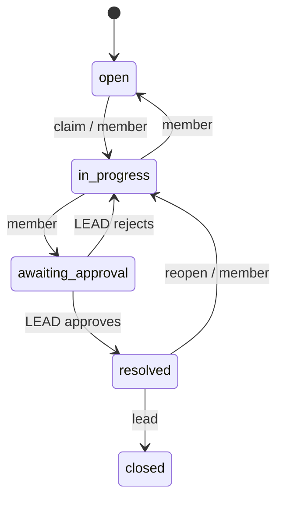

# Newtonite Ops — "Operations Under Pressure"

An internal web app to create, assign, track and resolve operational work items across teams. Server-enforced workflow, per-team roles, append-only history, and concurrency-safe actions (claim, versioned edits, idempotent retries, transactional outbox).

## Run (Node 18+)
```bash
npm install
npm start          # http://localhost:3000  (auto-creates data.db and seeds 4 teams, 10 users, 5000 items)
npm test           # 14 API-level tests, one command
# or: docker compose up --build   (data persisted in a volume)
```
Reset data: delete `data.db*` and restart. No secrets or env vars required (`PORT`, `DB_FILE` optional).

## Demo users (password for all: `password123`)
| User | Roles |
|---|---|
| admin | admin in all teams |
| alice | **lead** Payments, member Support |
| bob | member Payments |
| carol | **lead** Compliance |
| dave | member Compliance, viewer Payments |
| erin / frank | lead / member Support |
| grace / heidi | lead Platform / member Platform + Payments |
| ivan | viewer Platform |

Try it: log in as `bob`, claim an item, send it to *awaiting approval*; log in as `alice` → **Awaiting my approval** tab → approve.

## API
`POST /api/auth/login` · `GET /api/items?view=&status=&priority=&type=&team=&assignee=&q=&cursor=&limit=` · `POST /api/items` · `GET|PATCH /api/items/:id` · `POST /api/items/:id/claim` · `POST /api/items/:id/transition` · `POST /api/items/:id/comments` · `GET /api/items/:id/activity` · `GET /api/dashboard` · `GET /api/notifications`

## Workflow


## Critical behaviours (all tested in `test/api.test.js`)
1. **Concurrent claim** – single conditional `UPDATE … WHERE assignee_id IS NULL AND status='open'`; loser gets 409.
2. **Stale edits** – optimistic locking via `version`; mismatch → 409 with the latest item.
3. **Idempotency** – `Idempotency-Key` header; response stored and replayed (create, claim, transition).
4. **Workflow rules** – transition map checked server-side; approval is Lead-only.
5. **Resource-level authorization** – one `authorize()`/`can()` function; every query is scoped to the user's teams.
6. **Reliable async** – outbox row written in the same transaction; worker retries with exponential backoff, max 5 attempts, idempotent handler (`UNIQUE(outbox_id)`).
7. **Optimistic UI** – claim updates instantly and rolls back with the server's reason on 409/403.

## Advanced features
- **Full-text search** (SQLite FTS5, prefix match, kept in sync by triggers; hostile input is sanitised).
- **SLA automation:** urgent items still open and unassigned after 30 min (`ESCALATE_MINUTES`) are escalated once, logged as `System` in the history, and all Leads/Admins of the team are notified through the outbox.
- **Overdue tracking:** overdue dashboard tab, red due dates in lists, and a metrics strip (status counts, avg resolution time, busiest people) scoped to your teams (`GET /api/metrics`).
- **CSV export** of the current filter (`GET /api/items.csv`, capped at 10k rows, formula-injection safe).
- **Notifications panel** (the outbox results), **login rate limiting**, request IDs + JSON access logs, `/healthz`, Dockerfile + compose, GitHub Actions CI.

## Known limitations
- SQLite (single writer) instead of Postgres; see ENGINEERING_DECISIONS.md.
- Sessions are server-side tokens without refresh/revocation UI.
- Polling/refetch only (no websockets); no email delivery (notifications are rows).
- Existence of an item id is visible to non-members (403 vs 404); no rate limiting; frontend has no automated tests.

## Next week I would
Swap to Postgres (`SELECT … FOR UPDATE SKIP LOCKED` for the worker), add FTS/`pg_trgm` search, comment edit/delete audit, SLA/overdue views, and Playwright tests for the rollback flow.
